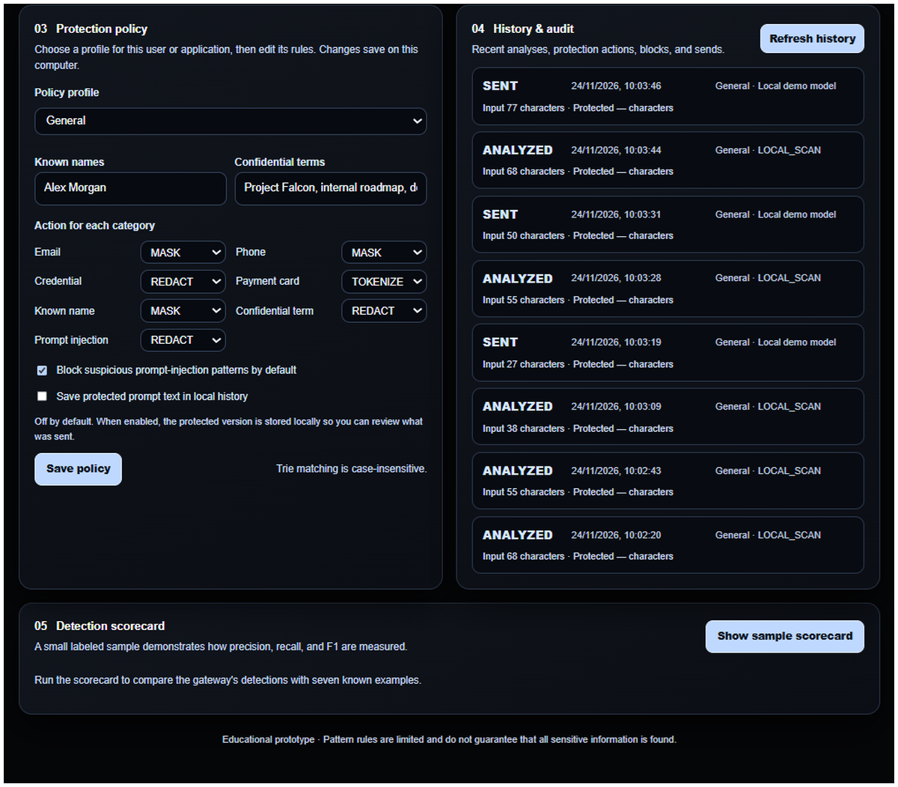
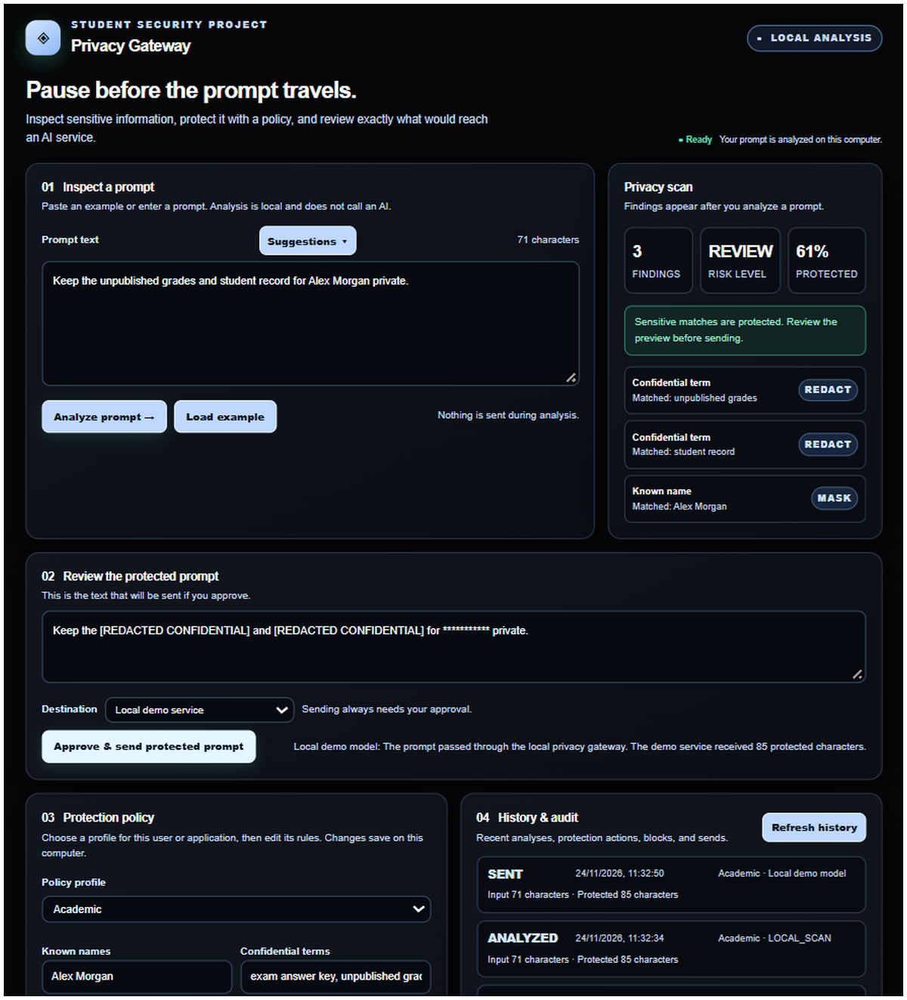

# Privacy and Safety Gateway

A small student project that checks a prompt before it reaches an AI service. The gateway looks for a few common kinds of sensitive information, shows what it found, and lets the user review a protected version. It also demonstrates several data structures and algorithms in a local web app.

The default demo runs with Python's standard library, so no extra packages or API key are needed.

## Run the project

1. Open PowerShell in this project folder.
2. Start the local app:

   ```powershell
   python app.py
   ```

   If your computer uses the Python launcher, use `py app.py` instead.

3. Open `http://127.0.0.1:8000` in your browser.
4. Choose **Load example** or type a sample prompt, then select **Analyze prompt**. Review the findings and protected preview. Nothing is sent during analysis.
5. To see the local demo response, select **Approve & send protected prompt**. A suspicious prompt is blocked unless you choose the one-time override.
6. Press **Ctrl+C** in PowerShell to stop the app.

The application is available only on your computer at `127.0.0.1`. The default destination is a local demo service, not an external AI. You can use it to explore the privacy checks without sending prompts to an API.

The **Suggestions** button provides sample prompts for testing. **History & audit** records each analysis and decision. Open a history entry to see its profile, destination, finding positions, categories, protection actions, and override status. The original prompt is not stored as a separate field. If you want to save the protected prompt in local history, turn on **Save protected prompt text in local history** in the policy panel. It is off by default.

The app also attempts to open the browser automatically. If it does not, copy the address printed in PowerShell into a new browser tab. Keep the PowerShell window open while using the page. If port 8000 is busy, run `python app.py --port 8001` and open `http://127.0.0.1:8001`.

## Optional live API

Live mode sends the protected prompt to the OpenAI chat completions endpoint. You still have to review and approve each send. To try it, set your API key in PowerShell and start the app with:

```powershell
$env:OPENAI_API_KEY = "your-api-key"
python app.py --live
```

Then select **OpenAI API** in the app. The key is read from the environment and is not saved in the project. Keep it out of the policy file and source code.

## What the gateway detects

- Email addresses
- Common phone number formats
- Credential assignments such as `password=...` or `api_key=...`
- Payment card numbers that pass the Luhn checksum
- Names and confidential phrases configured in the policy
- A small set of suspicious prompt-injection phrases

You can edit the sample names and confidential phrases in the app. This is a small set of rules for a class project; it will not recognize every possible name, credential, or reworded injection attempt.

## Protection and review

Each category can use one of three actions:

- **Mask:** replace each matched character with `*`.
- **Redact:** replace the matched value with a label such as `[REDACTED EMAIL]`.
- **Tokenize:** replace it with a numbered placeholder such as `[CARD_1]`.

After analysis, the app shows the matches and the text that would be sent. Suspicious prompt-injection phrases are blocked by default. The user can allow a blocked prompt once after reviewing it; the flagged text is still redacted.

## Data structures and algorithms used

These are the main DSA ideas in the project, with examples of where they appear in the code.

### Trie (prefix tree)

The Trie stores configured names and confidential phrases one character at a time. Phrases with a shared beginning reuse the same path: `internal memo` and `internal roadmap` both start with `internal `. The scanner follows those character paths to look for configured phrases in a prompt. In this implementation, the worst case is about `O(n × m)` checks, where `n` is the prompt length and `m` is the longest configured phrase. The Trie uses space proportional to the characters in the configured phrases.

### Other DSA concepts

- **Hash maps (`dict`):** Trie nodes map a character to the next node. Dictionaries also map categories to actions and keep track of numbered tokens such as `[CARD_1]`.
- **Lists:** keep the detected findings and the pieces used to assemble the protected prompt.
- **Sorting:** puts findings in a consistent order. Suspicious instructions get priority, and the final findings are ordered by their positions in the prompt.
- **Greedy overlap selection:** when two detections cover the same text, the scanner keeps the higher-priority match and skips the overlapping one.
- **Linear scan and string building:** after selecting matches, the program walks through the prompt from left to right and joins unchanged text with its replacements.
- **Luhn checksum:** card-shaped number matches are checked with a right-to-left digit algorithm before they are treated as card findings. Passing the checksum does not prove a number belongs to a real card.

## Project stages

1. **Check:** regular expressions look for common formats such as emails and phone numbers. The Trie looks for names and phrases from the selected policy.
2. **Protect:** the policy decides whether each match should be masked, redacted, or replaced with a token.
3. **Review:** the user checks the findings and protected preview. The app blocks detected injection phrases by default.
4. **Record:** the gateway writes privacy-related metadata to local history.
5. **Try and measure:** the local demo shows the protected prompt passing through the gateway. An optional API mode and a small scorecard are also available.

## Detection scorecard

Click **Show sample scorecard** in the app to compare seven sample prompts with their expected detection categories. It reports:

- **Precision:** of the categories detected, how many were expected?
- **Recall:** of the expected categories, how many were found?
- **F1:** a combined score based on precision and recall.

This score only describes the built-in examples. Seven prompts are not enough to show how well the gateway would work on real-world data.

To print the same sample report in PowerShell, run:

```powershell
python benchmark.py
```

## Privacy audit and saved policy

The app starts with profiles in `data/policy.json`. Changes are saved on your computer in `data/policy.local.json`, and the audit log is written to `data/audit.jsonl`. These local files are excluded from Git. The General, Academic, and Business profiles show how different applications can use different rules. History records when an action happened, the selected profile and destination, what categories were found, which protections were applied, and whether an injection override was used. The original prompt is not stored separately. Protected prompt text is saved only if you enable that option in the policy panel. In live mode, the chosen AI service receives the protected prompt after you approve it.

## Files

```text
app.py                 Local web server and optional API adapter
privacy_gateway.py     Trie, detectors, policies, and protection actions
benchmark.py           Sample prompts and scorecard calculation
web/index.html         Browser interface
data/policy.json       Default policy profiles
data/audit.jsonl       Local audit log, created when the app runs
```

## Screenshots

Here are a few views of the app while it checks sample prompts, applies policies, records decisions, and blocks a suspicious instruction. The screenshots use example data.








## Limitations

- The detectors use a small collection of regular expressions and phrases. They may miss sensitive information or flag ordinary text.
- Names are found only if they have been added to the selected policy.
- A card number that passes the Luhn check is not necessarily a real or active card.
- Token placeholders are not reversible; the app does not keep a private mapping to the original values.
- This project is for learning and demonstration. It should not be used as a production security system.
